# Siron SQL Tracer

Siron AML'den yeni sisteme geçişte **hangi ekranın hangi tablo ve kolonları kullandığını**, tablolar
arasındaki **ilişkileri** ve **taşınacak verinin nasıl çekileceğini** ortaya çıkaran Python + Flask uygulaması.
Kaynak: Siron DB kullanıcısının Oracle audit kayıtları (19c unified auditing).

Sadece Python gerekir; `python-oracledb` thin mode ile Oracle Client kurmadan bağlanır.
Arayüz internet bağlantısı gerektirmez (CDN yok).

## Ne yapar?

| Soru | Özellik |
|---|---|
| Bu ekran hangi tabloları kullanıyor? | **Ekran yakalama**: Başlat → Siron'da ekranı kullan → Durdur. O aralıktaki tüm SQL'ler audit'ten alınır, SQL_ID hesaplanır |
| Ekranda gösterilen alanlar hangi kolonlardan geliyor? | **Kolon analizi**: her kolon için kullanım türü — *gösterim* (SELECT listesi), *filtre/join*, *sıralama*, *yazma* (INSERT/UPDATE) |
| Ekranda gördüğüm "AHMET YILMAZ" hangi tablo/kolonda? | **Ekrandaki değeri bul**: ekranın SQL'leri bindleriyle tekrar çalıştırılır, değer sonuçlarda aranır ve sonuç kolonu `TABLO.KOLON`'a eşlenir. Alternatif: ekranın tablolarının kolonlarında arama |
| Sorgu tam olarak neydi, sonucu neydi? | **SQL detayı**: biçimlendirilmiş SQL, alias'lar, JOIN koşulları, bind değerleri (düzenlenebilir), bindleri yerleştirilmiş SQL, salt-okunur çalıştırma, sonuç kolonlarının kaynak tablo.kolon bilgisi |
| Tablolar birbirine nasıl bağlı? | **İlişki keşfi**: (1) FK constraint'leri, (2) Siron'un kendi SQL'lerindeki JOIN koşulları — constraint olmasa da gerçek ilişkidir, (3) kolon adı + tip uyumu tahmini. Güven puanı 0-100; tahminler **veriyle doğrulanabilir** |
| Görsel model? | **ER diyagramı**: sürüklenebilir, taşıma durumuna göre renkli; Mermaid / Graphviz / SVG olarak dışa aktarılır |
| Taşınacak veriyi nasıl çekerim? | **Sorgu oluşturucu**: seçilen tabloları en güvenilir ilişki yolu üzerinden (gerekirse ara tablolarla) JOIN'leyen SELECT'i üretir. Sonucun **tamamı CSV** olarak indirilebilir |
| Kararları nerede tutarım? | **Notlar**: tablo ve kolon başına durum (*Taşınacak / İncelenecek / Gereksiz*), hedef alan (yeni sistem) ve iş anlamı |
| Ekibe ne veririm? | **Kolon eşleme matrisi** (ekranda / CSV) ve **tek dosyalık HTML rapor**: ekran envanteri, veri sözlüğü, kullanım, notlar, ilişkiler, ER, SQL'ler, örnek sonuçlar. Kişisel veri için **maskeleme** seçeneği |
| Tek bir sorgunun sonucunu paylaşmak? | **Sonucu HTML indir** (maskeli olabilir) veya **rapora ekle** |

## Kurulum

```bash
python -m venv .venv
.venv\Scripts\activate          # Linux: source .venv/bin/activate
pip install -r requirements.txt
copy config.example.ini config.ini   # Linux: cp
# config.ini: [oracle] dsn/user/password, [siron] db_user (Siron'un bağlandığı kullanıcı)
python run.py                   # http://127.0.0.1:5000
```

Makinede internet yoksa paketleri başka bir makinede indirip taşıyın:
`pip download -r requirements.txt -d wheels` → hedefte `pip install --no-index --find-links wheels -r requirements.txt`
(iki makinenin Python sürümü / işletim sistemi aynı olmalı).

## Oracle tarafı

Audit'i kendi yönteminizle açın. Uygulama audit politikasının adından ve kapsamından bağımsızdır;
`UNIFIED_AUDIT_TRAIL`'i yalnızca `[siron] db_user` kullanıcısına ve zaman aralığına göre okur.
Tek şart, Siron'un bağlandığı DB kullanıcısının audit kapsamında olmasıdır.

- Uygulama kendi (DBA) kullanıcınızla bağlanabilir; **Siron kullanıcısıyla bağlanmayın** (bu uygulamanın sorguları karışır).
  "Kontrol" sayfasında `UNIFIED_AUDIT_TRAIL` için yetki hatası görürseniz: `GRANT AUDIT_VIEWER TO <kullanıcınız>;`
- Audit **yeni oturumlarda** devreye girer: açtıktan sonra Siron'un connection pool'unu yenileyin.
- Sorgular `ALTER SESSION SET CURRENT_SCHEMA = <ilk şema>` ve `SET TRANSACTION READ ONLY` ile salt-okunur çalışır.
  Yalnızca `SELECT` / `WITH` kabul edilir.

## Önerilen çalışma akışı

1. **Kontrol** sayfasında bağlantıyı ve audit kayıtlarını doğrulayın; ana sayfadan **Veri sözlüğünü yükle**
   (kolonlar, tipler, açıklamalar, PK/UK/FK, satır sayıları — kolon analizi, ilişki tahmini ve değer arama bunu kullanır).
2. Siron'da hiçbir şey yapmadan 1-2 dakikalık bir yakalama alıp **Gürültü olarak işaretle**: arka plan / heartbeat
   SQL'leri diğer yakalamalardan otomatik ayıklanır.
3. Her ekran / sekme / işlem için ayrı yakalama alın. Mümkünse test ortamında ve tek başınıza çalışın
   (Siron tek DB kullanıcısıyla bağlandığı için diğer kullanıcıların SQL'leri de aynı aralığa düşer; filtreler: OS kullanıcısı, host, program, client id).
4. Ekranın **Kolonlar** sekmesi neyin gösterildiğini verir; emin olmadığınız alanlar için **Ekrandaki değeri bul**.
5. **Tablolar** ve tablo sayfalarında durum / hedef alan / not girin. **Kolon eşleme** sayfası göç matrisidir.
6. **İlişkiler** sayfasında tahminleri **veriyle doğrulayın**; **ER diyagramı** ile modeli gözden geçirin.
7. **Sorgu oluşturucu** ile veri çekme sorgularını hazırlayın, sonucu CSV alın.
8. **Raporlar**'dan proje veya ekran raporunu üretin (HTML; tarayıcıdan PDF'e yazdırılabilir).

## Ekranlar

(Ekran görüntülerindeki veriler örnektir.)

| | |
|---|---|
| 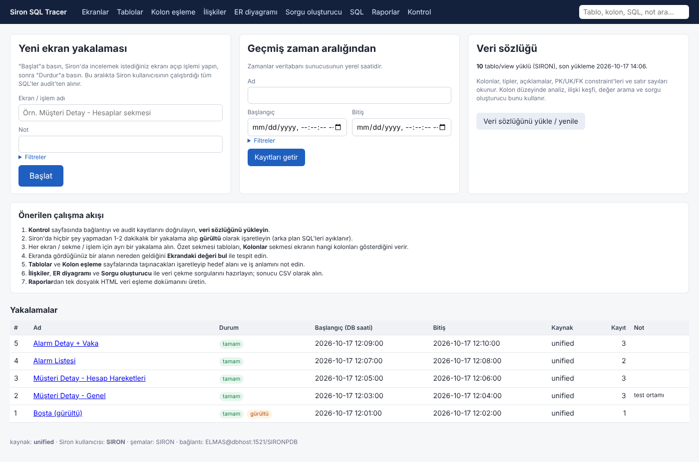 | 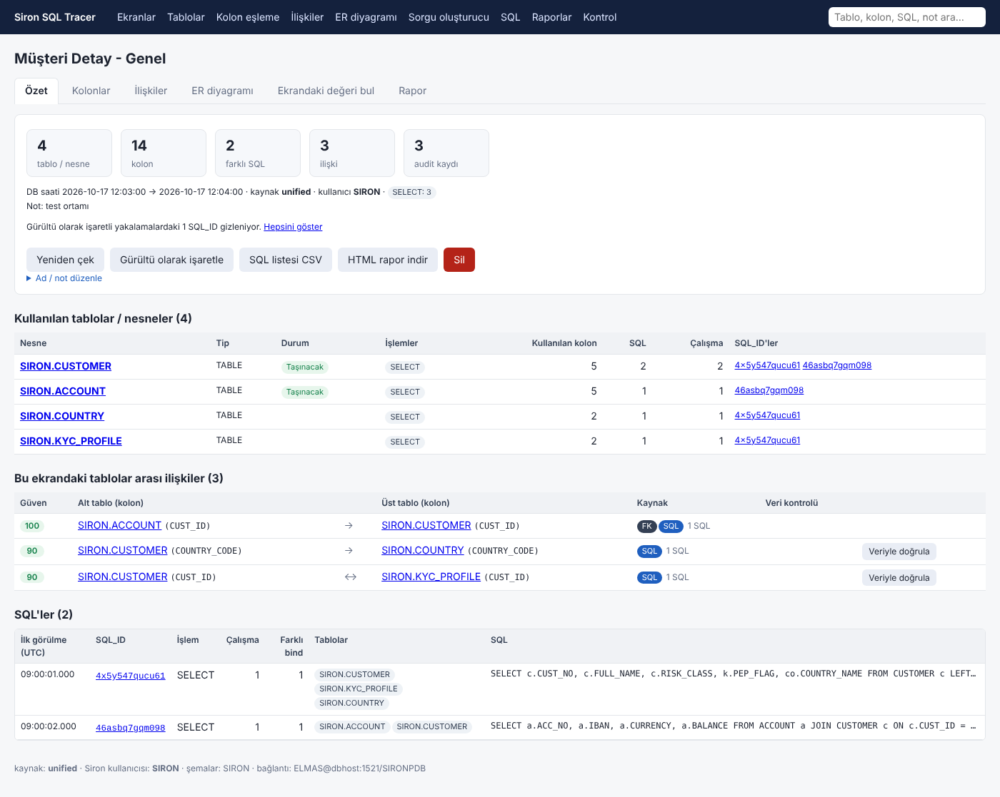 |
| 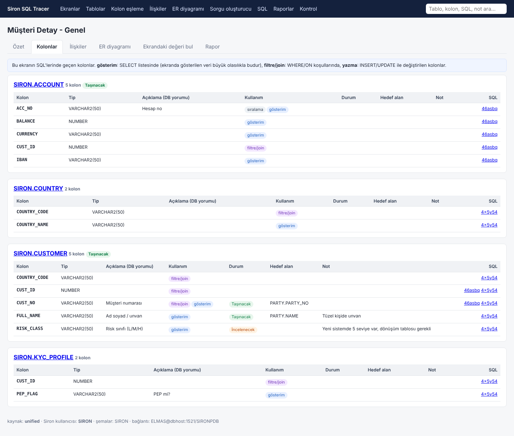 | 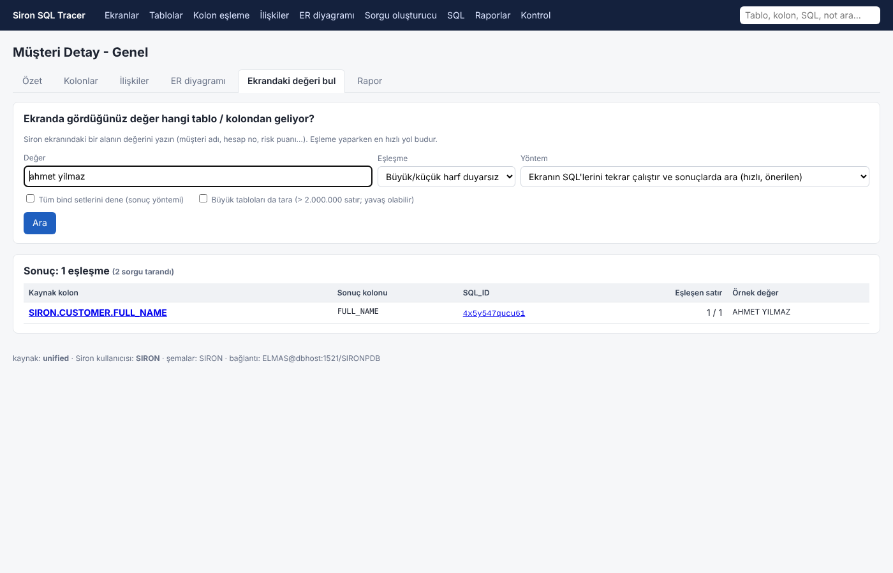 |
| 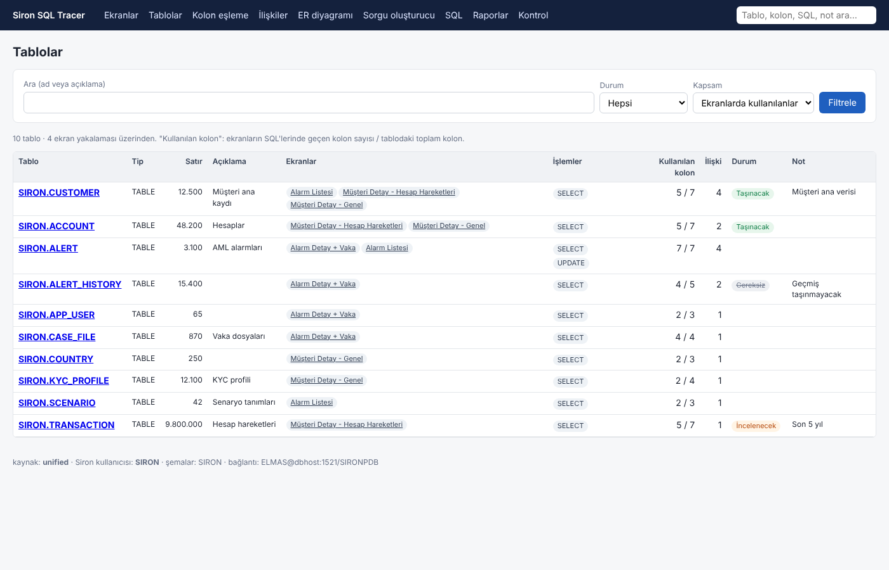 |  |
| 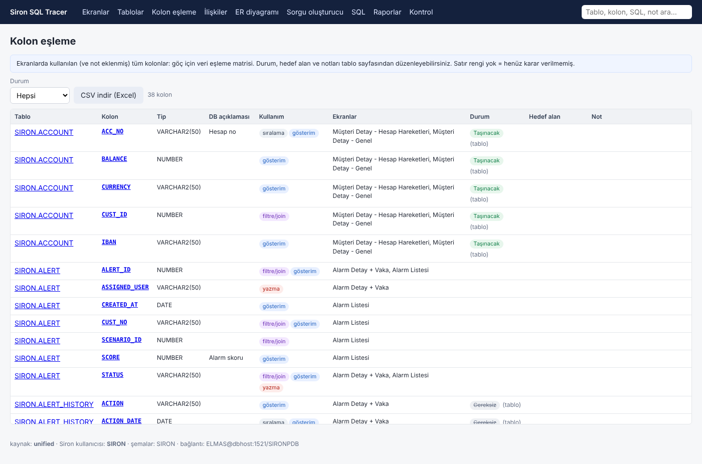 | 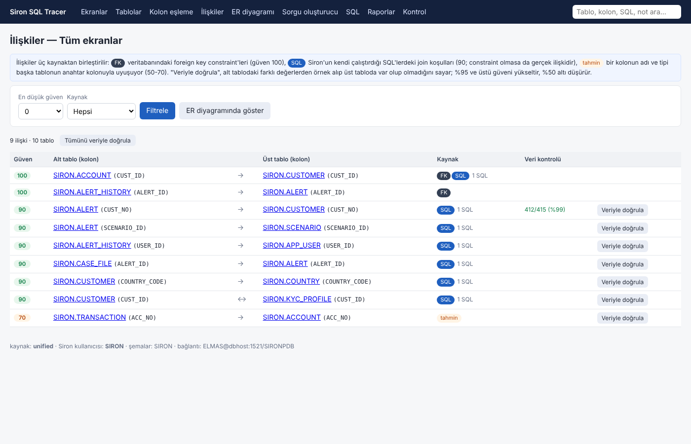 |
| 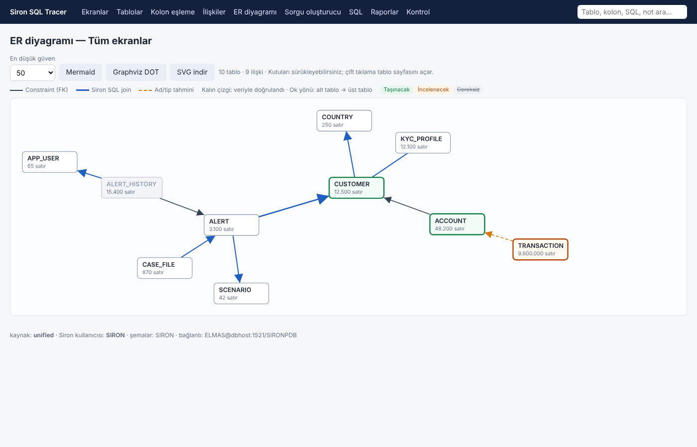 | 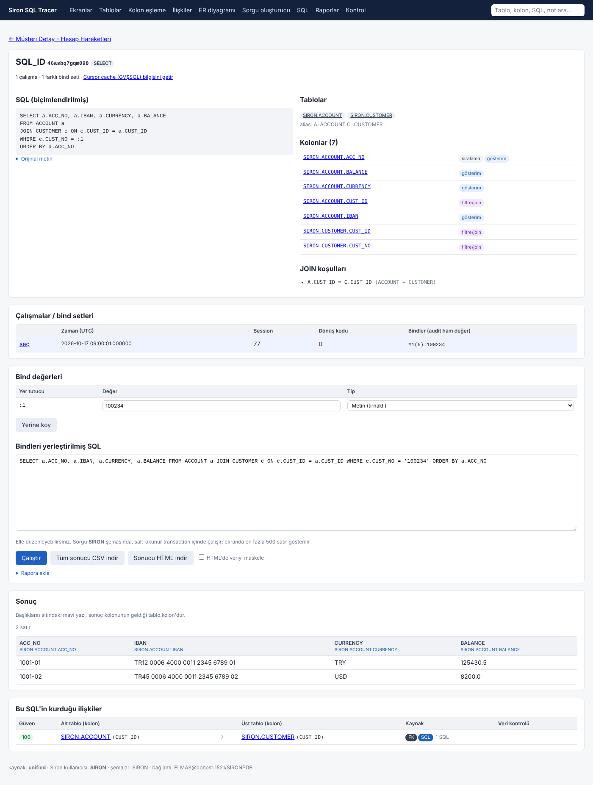 |
| 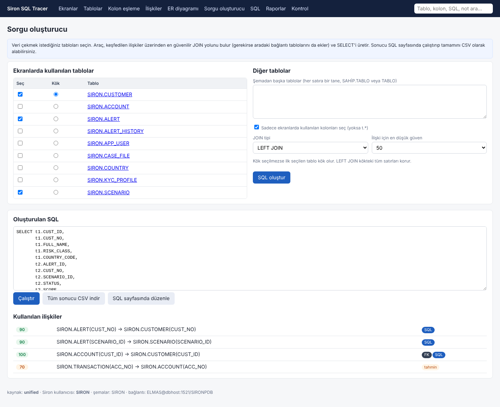 | 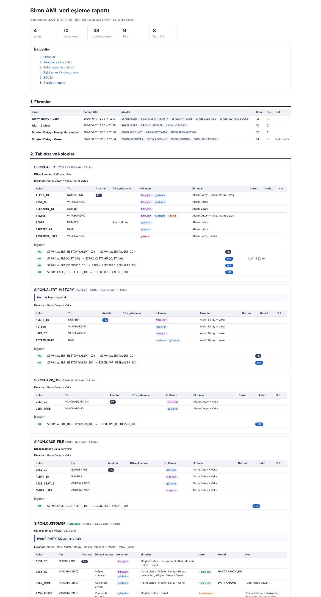 |

## Audit kaynakları (`config.ini` → `audit_source`)

| Değer | Ne okur | Not |
|---|---|---|
| `unified` | `UNIFIED_AUDIT_TRAIL` | 19c. SQL_TEXT tam, SQL_BINDS dolu. Önerilen |
| `traditional` | `DBA_AUDIT_TRAIL` | SQL metni 2000 karakterde kesilir |
| `aud$` | `SYS.AUD$` | Traditional ama tam SQL metni |
| `cursor_cache` | `GV$SQL` + `GV$SQL_BIND_CAPTURE` | Audit gerektirmez; hızlı ön keşif. Bindler örneklenmiş, her SQL için tek satır |

## Nasıl çalışır? (teknik notlar)

- **SQL_ID:** `MD5(sql_text || CHR(0))` özetinin son 8 baytı base32 ile kodlanır; V$SQL'deki SQL_ID ile birebir aynıdır.
- **Bindler:** audit `#1(4):1001 #2(5):AHMET` yazar; uzunluk bilgisiyle ayrıştırılır (boşluklu ve çok baytlı değerler dahil).
  `:1`, `:B1`, `:isim`, `?` yer tutucuları string/yorum dışında bulunur; aynı isim birden çok geçiyorsa isimle eşlenir.
  Değer tipi satır bazında *Metin / Sayı / Ham ifade / NULL* seçilebilir.
- **SQL analizi** (`sqlinsight.py`): alias çözümleme (ORM tarzı `customer0_` dahil), ANSI ve eski tip (`(+)`) join'ler,
  alt sorgular, CTE'ler, `SELECT *`; şemasız kolonlar veri sözlüğüyle tek tabloya çözümlenir. Tam bir SQL parser değildir;
  tanımadığı yapıda hata vermez, yalnızca daha az bulgu üretir.
- **İlişki yönü:** JOIN'de anahtar (PK/UK) olan taraf üst tablodur; anahtar bilinmiyorsa kolon adına bakılır
  (`CUSTOMER_ID` → `CUSTOMER`), karar verilemezse ilişki yönsüz (↔) gösterilir.
- **Veriyle doğrulama:** alt tablodan en fazla 5000 dolu satır örneklenir, farklı değerlerin üst tabloda bulunma oranı hesaplanır.
  %95+ güveni en az 85'e çıkarır, %50 altı 25'e düşürür.
- **Değer arama (tablo yöntemi)** her tabloyu tek sorguyla tarar; `big_table_rows` üstündeki tablolar istenmedikçe atlanır.
- **Yerel depo:** yakalanan kayıtlar, veri sözlüğü, notlar ve rapor sonuçları `data/siron_tracer.db` (SQLite) dosyasındadır.
  Audit temizlense de analiz kaybolmaz; dosyayı yedekleyerek çalışmayı taşıyabilirsiniz.
- **Güvenlik:** uygulama varsayılan olarak yalnızca `127.0.0.1`'den erişilebilir ve kimlik doğrulaması yoktur; ağa açmayın.
  Raporlar AML verisi içerebilir — paylaşmadan önce maskeleme seçeneğini kullanın.
- **Oracle 11g veya Native Network Encryption** zorunluysa `client_lib_dir` ile Instant Client göstererek thick mode kullanın.

## Geliştirme

```bash
pip install pytest
python -m pytest
```

| Modül | İçerik |
|---|---|
| `sqlutil.py` | SQL_ID, bind ayrıştırma / yerleştirme, tablo referansları, SQL biçimlendirme |
| `sqlinsight.py` | Alias, kolon kullanımı, JOIN koşulları, SELECT listesi → kaynak kolon |
| `catalog.py` | Veri sözlüğü modeli (tablo, kolon, PK/UK/FK) |
| `relations.py` | İlişki keşfi, JOIN yolu, SELECT üretimi, Mermaid/DOT |
| `finder.py` | Değer arama ve maskeleme |
| `layout.py` | ER diyagramı yerleşimi |
| `analysis.py` | Ekran ve proje düzeyinde analiz |
| `sources.py`, `oracle.py` | Audit kaynakları ve Oracle erişimi |
| `store.py` | SQLite deposu |
| `views*.py`, `templates/` | Flask arayüzü ve raporlar |
